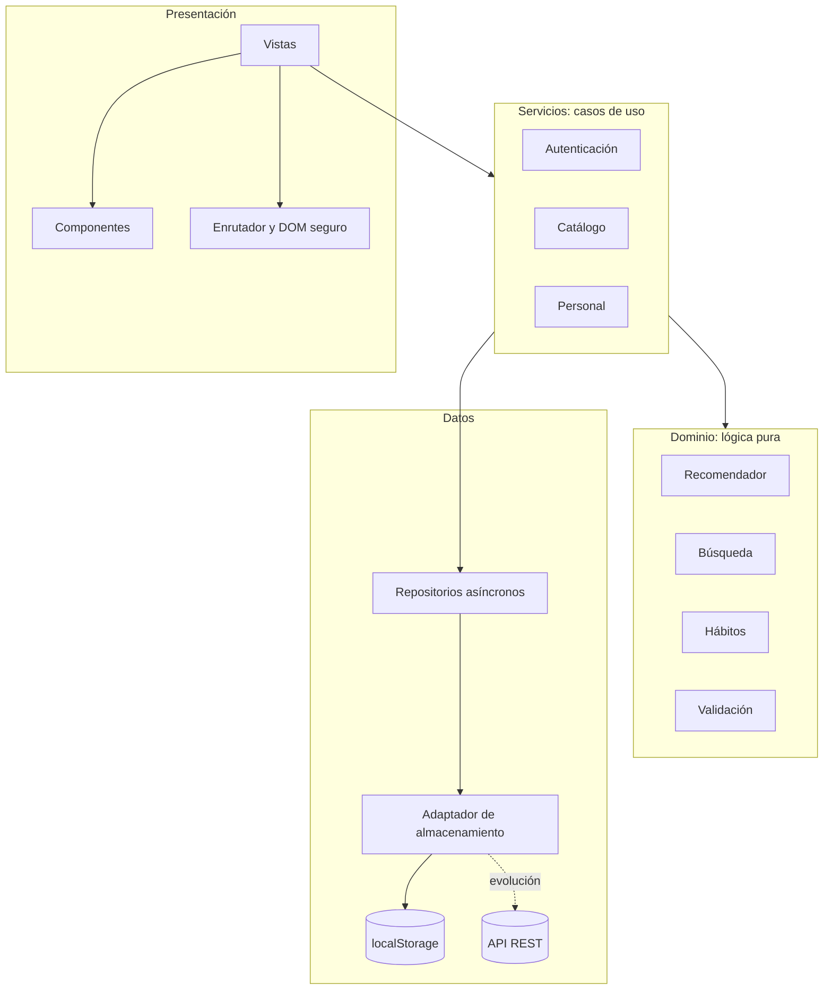

# 03 · Arquitectura y decisiones

## Vista general

Casa Activa es una aplicación de una sola página, publicada como sitio estático. Se organiza por capas con
dependencias en un solo sentido: lo de arriba conoce lo de abajo, nunca al revés.

| Capa | Responsabilidad | Regla |
|---|---|---|
| Presentación (`vistas`, `ui`, `nucleo`) | Dibuja y captura la interacción | No contiene reglas de negocio |
| Servicios (`servicios`) | Orquesta casos de uso | Único punto que combina dominio y datos |
| Dominio (`dominio`) | Reglas de negocio | Sin DOM ni almacenamiento: se prueba directamente en Node |
| Datos (`datos`) | Persistencia | Interfaz asíncrona, igual a la de una API |

`src/main.js` es la raíz de composición: el único archivo que conoce las implementaciones concretas.

## Motor de personalización

1. **Seguridad:** descarta lo incompatible con dieta, restricciones y condiciones. Ningún puntaje la supera.
2. **Puntuación (0 a 100):** objetivo 40, nivel 20, tiempo 15, necesidad 15, afinidad 10.
3. **Diversidad:** máximo 4 recomendaciones por categoría.
4. **Explicación:** cada criterio cumplido se convierte en una razón visible.

El IMC se calcula con fines informativos, pero no se usa para recomendar: la OMS señala otras medidas, como el perímetro de la cintura, y decidir contenido de salud con un solo número sería poco prudente.

## Modelo de datos

| Clave | Contenido |
|---|---|
| `esquema` | Versión aplicada, para las migraciones |
| `usuarios` | Cuenta, rol, credencial PBKDF2 y consentimientos |
| `perfiles` | Perfil de salud por usuario |
| `contenidos` | Recomendaciones y su estado |
| `favoritos`, `descartes` | Identificadores por usuario |
| `habitos`, `registros` | Hábitos y fechas cumplidas |
| `sesion`, `intentos` | Sesión activa y control de intentos fallidos |

## Registro de decisiones (ADR)

### ADR-001. Sitio estático sin servidor

**Contexto:** la rúbrica evalúa un enlace que el docente debe poder abrir en cualquier momento.
**Decisión:** SPA estática publicada en GitHub Pages.
**Consecuencias:** sin costo ni arranque en frío. Los datos quedan en cada navegador, y la seguridad no puede
imponerse del lado del servidor. Es aceptable para un prototipo y se declara en el informe.

### ADR-002. Sin framework ni compilación

**Contexto:** el MVP es HTML y CSS, y la instrucción es evitar reescrituras innecesarias.
**Decisión:** JavaScript con módulos nativos y un constructor mínimo de DOM.
**Consecuencias:** el código se ejecuta tal como se escribe y el peso es bajo (cerca de 68 KiB transferidos con compresión).
A cambio, hay más peticiones, lo que se compensó con `modulepreload`.

### ADR-003. Repositorios asíncronos

**Contexto:** `localStorage` es síncrono, pero una API no lo sería.
**Decisión:** todos los repositorios devuelven promesas, aunque hoy no lo necesiten.
**Consecuencias:** migrar a un servidor no obliga a cambiar servicios ni vistas.

### ADR-004. Reglas explicables en lugar de aprendizaje automático

**Contexto:** no hay datos de uso, y en temas de salud cada sugerencia debe poder explicarse.
**Decisión:** motor de reglas con pesos conocidos.
**Consecuencias:** es verificable y determinista. No aprende por sí mismo.

### ADR-005. PBKDF2 con Web Crypto

**Contexto:** se necesita proteger contraseñas sin dependencias externas. Argon2 no está disponible en el navegador.
**Decisión:** PBKDF2-HMAC-SHA256 con sal aleatoria y 600 000 iteraciones, según OWASP. Cada credencial guarda
sus iteraciones, para poder elevarlas en el futuro.

### ADR-006. Construcción del DOM sin `innerHTML`

**Contexto:** la administración permite publicar texto que ven otras personas, lo que abre la puerta a XSS.
**Decisión:** todo el contenido entra como nodo de texto. Una prueba falla si aparece `innerHTML` en `src/`.

### ADR-007. Enrutamiento por hash

**Contexto:** GitHub Pages no reescribe rutas hacia `index.html`.
**Decisión:** rutas tipo `#/explorar?q=sueño`.
**Consecuencias:** funciona en cualquier hosting estático y cada pantalla tiene una URL compartible.

## Evolución a producción

| Hoy | Producción |
|---|---|
| `localStorage` | API REST con base de datos |
| Hash en el navegador | Autenticación en el servidor con Argon2id |
| Roles en la interfaz | Autorización en cada petición |
| Perfil sin cifrar en el dispositivo | Cifrado en reposo y registro de accesos |
| CSP en `<meta>` | Cabeceras HTTP, incluida `frame-ancestors` |
| Sin recuperación de contraseña | Enlace temporal por correo |
